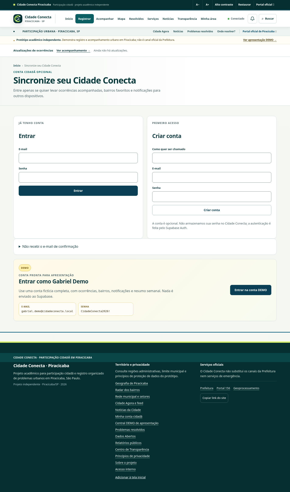
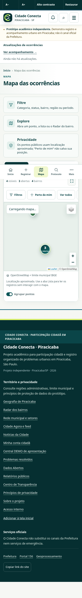
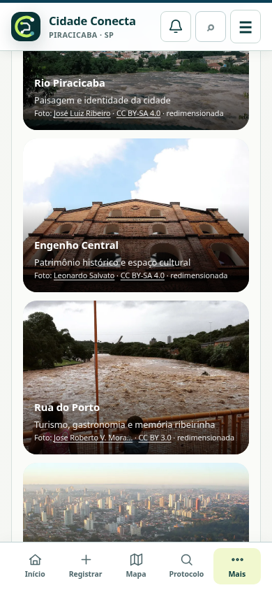

# Cidade Conecta Piracicaba — publicação e validação no Google

Validação em 11/11/2026, horário de São Paulo. O frontend está publicado e verificado em https://cidade-conecta-piracicaba.web.app/, independente de GitHub Pages. Backend mantido em `qzpofoxxrjunyayczcfu`. O projeto Google dedicado é `cidade-conecta-piracicaba`.

**Pendente: concluir a configuração e o teste real de confirmação por e-mail.** O redirecionamento do Supabase Auth ainda responde com `http://localhost:3000`. A conexão disponível permite administrar funções e consultar o projeto, mas não editar a configuração de URLs do Auth. Nenhuma confirmação real foi anunciada como validada e nenhum usuário foi promovido ou criado para contornar essa etapa.

## O que mudou

- Cadastro e reenvio informam o endereço exato da hospedagem atual, sem parâmetros de campanha ou fragmento.
- O retorno de confirmação limpa tokens da URL, valida o usuário no Auth e carrega a conta cidadã; links expirados ou incompletos mostram orientação.
- A conta pendente oferece reenvio, retorno ao login e continuação sem cadastro.
- Falhas de perfil não aparecem como login bem-sucedido; erros comuns de autenticação têm mensagens em português.
- E-mail reservado da DEMO não é enviado ao Auth quando a senha está incorreta nem permite cadastro real. A sessão DEMO permanece separada do Admin e das contas cidadãs.
- Hosting publica somente uma lista explícita de arquivos do frontend, com canonical, sitemap e Open Graph ajustados à URL Google na cópia de publicação. Arquivos inexistentes retornam 404.
- As nove funções oficiais receberam apenas os dois domínios Firebase na lista de origens permitidas. Autorização, payloads, destinos, segredos, validação JWT e papéis foram preservados. Código publicado foi comparado com a `main` antes da alteração.
- QR Code PNG de 3280 × 3280 pixels, 300 dpi, com margem de leitura e correção Q; leitura verificada em tamanho original, 600 e 300 pixels, e no arquivo baixado do site.

## Etapas conferidas em sessões anônimas

| Etapa | Fluxo | Resultado e limite |
| --- | --- | --- |
| 1 | Página inicial e navegação | Aprovados; computador, menu de celular e transições entre páginas. |
| 2 | Registro sem cadastro | Formulário acessível sem autenticação. Não foi enviado relato fictício à base real. |
| 3 | Mapa e lista | Leaflet, pontos, agrupamentos e lista funcionando. O serviço externo IBGE respondeu indisponível para o limite municipal; tiles também dependem do OpenStreetMap. |
| 4 | Notícias, imagens e links | Notícias com vazios honestos, fotografias locais carregadas, créditos/licenças e links HTTPS das fontes presentes. A visita às páginas de terceiros não foi tratada como garantia permanente de disponibilidade. |
| 5 | DEMO, protocolo e saída | Login DEMO, consulta de protocolo fictício e saída sem chamadas ao Auth real; protocolo inexistente mostra erro. |
| 6 | Conta real e Admin | Formulários de login/cadastro, reenvio e bloqueio do Admin anônimo conferidos. Retorno, login e saída reais dependem da configuração e confirmação de e-mail abaixo; nenhum papel interno foi concedido para QA. |
| 7 | Divulgação | Domínios Google respondem HTTP 200; versão publicada e QR conferidos. Arquivo backend de teste retorna 404 no Hosting. |

Capturas atuais, sem dados de contas reais:

## Testes e evidências

- `node --test scripts/test-*.mjs`: **164 aprovados, 0 falhas**, incluindo 10 testes comportamentais novos de cadastro/retorno/reenvio/saída e isolamento DEMO.
- Smoke existente em Chromium: **163 cenários aprovados**, com fixtures, falhas de rede, Admin, mapas e isolamento de contas. Inclui comparação de desempenho de laboratório, sem substituir Core Web Vitals.
- Site publicado: **21 combinações de tela/rota**, em 1366, 390 e 320 pixels, sem estouro horizontal ou exceções JavaScript; **14 verificações de interação** em sessões anônimas de computador e celular.
- CORS real das nove funções: **27/27** verificações aprovadas; duas origens Firebase aceitas e origem não autorizada recusada.
- HTTP do backend oficial: **10/10** verificações de acesso público/negação anônima aprovadas.
- Validação territorial/estática: **288 itens OK**; o aviso preexistente do Guamium em duas regiões foi preservado por refletir a base territorial.
- Recovery e privacidade do cliente aprovados; nenhuma chave privada no pacote público.
- Workflow GitHub no commit `b4eed1a`: https://github.com/gabrieldomingues2005-arch/Cidade-Conectaprojeto/actions/runs/43112664981 .

JSONs estão em [qa-firebase-20261111](qa-firebase-20261111/). As capturas confirmam renderização e comportamento observado, sem atestar conformidade completa de acessibilidade. Preferências, rascunhos e códigos privados salvos no GitHub Pages pertencem àquela origem; não são copiados automaticamente para o novo domínio.

## Passo exato para concluir o e-mail

1. Abrir https://supabase.com/dashboard/project/qzpofoxxrjunyayczcfu/auth/url-configuration .
2. Definir Site URL como `https://cidade-conecta-piracicaba.web.app/`.
3. Preservar URLs atuais e acrescentar os redirecionamentos exatos `https://cidade-conecta-piracicaba.web.app/` e `https://cidade-conecta-piracicaba.firebaseapp.com/`.
4. Salvar. A confirmação de e-mail deve continuar habilitada.
5. Cadastrar a caixa de teste autorizada no formulário publicado. Conferir recebimento, abrir o link original, verificar retorno ao domínio Google e sessão cidadã; depois sair, entrar com a senha e sair novamente. Conferir também que essa conta não entra no Admin.

Se o serviço de envio bloquear destinatários, configurar o provedor de e-mail no mesmo projeto oficial antes de repetir; não desligar a confirmação. Esta hipótese ainda não foi observada em um envio real desta entrega.

Não foi acessado nem alterado o Supabase do Raiz Carbon.
