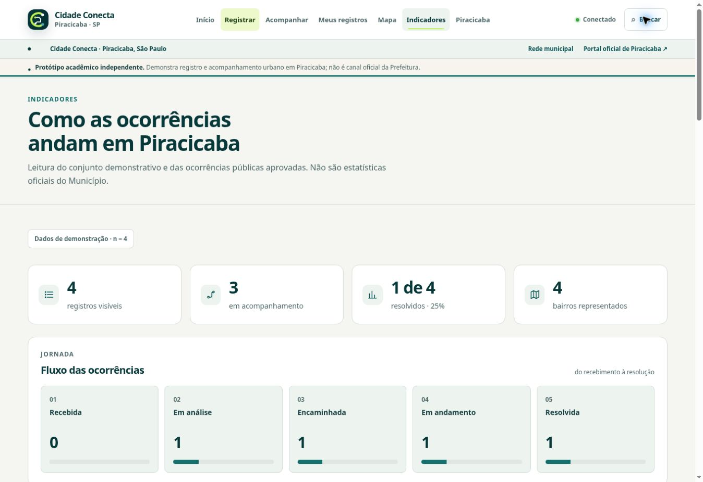

# Entrega de Product Design — Cidade Conecta Piracicaba

02/11/2026 · Branch `feature/cidade-conecta-design-system-20261102` · [PR #8 em rascunho](https://github.com/gabrieldomingues2005-arch/Cidade-Conectaprojeto/pull/8).

Revisão incremental sobre `37c161eb63dc15935cbaf4b7b4e1672d82e8778d`. A interface usa a aplicação e a marca existentes, com identidade cívica em verde profundo e lima, escala tipográfica consistente, superfícies claras e menos efeitos decorativos. [Design System 6](../../DESIGN-SYSTEM.md) contém os tokens e contratos; a [auditoria inicial](AUDITORIA.md) registra os sete passos inspecionados antes das mudanças.

## Mudanças entregues

| Área | Resultado |
|---|---|
| Sistema visual | Tokens CSS para cor, texto, pesos, entrelinha, espaços, raios, sombras, controles, foco e movimento; camada única de evolução sobre o CSS existente |
| Navegação | Destinos visíveis no desktop; menu com estado anunciado, Escape e fechamento externo; barra mobile preservada; busca sem mudar a rota ao abrir |
| Home | Hierarquia entre apresentação, registro, protocolo e leitura territorial; mapa e métricas organizados; marca e aviso de independência preservados |
| Registro | Etapas e privacidade próximas da tarefa; controles legíveis; categoria com semântica de rádio e setas/Home/End; rótulos completos em telas estreitas; prévia pública preservada |
| Acompanhamento | Campo e formato do protocolo claros, orientação para encontrar o código e explicar a dependência do aparelho de origem |
| Mapas e território | Filtros, títulos, lista, tabs e regiões com leitura e toque melhores; uma coluna no celular e duas no tablet; atribuição habilitada na Home; nenhum nome ou polígono inventado |
| Indicadores | Valores tabulares, escala consistente de KPIs e painéis; estado vazio explícito; origem demonstrativa/pública identificada |
| Rede municipal | Categorias com quebra de linha em vez de corte horizontal; competências, canais e links legíveis |
| Admin | Entrada compacta; tabela com caption, cabeçalhos e ações nomeadas; linhas em cartões no celular, com título e status legíveis; acesso e leitura segura preservados |
| Consistência dos dados | Resumos territoriais passam a usar a mesma visão pública sanitizada dos indicadores; consulta dos registros do próprio navegador continua separada |
| Estados e acabamento | Foco visível, controles compactos de pelo menos 44 px, tratamento visual de vazio/erro/offline, sem pulso contínuo; animações CSS respeitam redução de movimento |
| PWA | CSS e scripts visuais versionados; precache das URLs exatas usadas no HTML, inclusive no primeiro carregamento offline; respostas privadas continuam fora do cache |

## Verificação

Código final de UI verificado: `b4a491c445f62f1a4743794a67886890e346b1cc`. [CI completo aprovado, execução 149](https://github.com/gabrieldomingues2005-arch/Cidade-Conectaprojeto/actions/runs/41506663925). Os commits de fechamento acrescentam documentação, evidências e uma correção do teste de contraste para extrair a paleta padrão diretamente de `:root`, sem usar overrides de alto contraste. A paleta padrão também passou nos testes. Os checks do HEAD permanecem disponíveis no PR #8.

| Verificação | Resultado | Evidência / limite |
|---|---|---|
| Sintaxe JS, shell e manifesto | PASS | Todas as etapas correspondentes do CI |
| Auth, Edge, PWA e design | PASS | 62 testes, zero falhas; inclui isolamento de acesso, não cachear dados privados, contraste dos tokens e tabela com conteúdo escapado |
| Validação estática | PASS | 283 verificações; aviso conhecido do Guamium em R2/R3 preservado |
| Recovery validator | PASS | Invariantes e base territorial preservados |
| Responsividade | PASS | 13 rotas × 320/390/768/1366 px = 52 combinações, sem overflow horizontal, campo cortado, campo sem nome ou exceção JS |
| Estados do Admin | PASS | 7 cenários: indisponível, falha de rede, timeout, offline, 401, 403 e vazio; sessão preservada ou invalidada conforme contrato |
| Admin preenchido | PASS | Fixtures em 320, 390 e 1366 px; busca, limpar filtros e detalhe; nenhuma conta ou permissão real criada |
| Busca por teclado | PASS | Ctrl+K preserva rota, fundo inerte, Tab/Shift+Tab contidos, Escape e retorno ao botão de origem |
| Formulário e privacidade da prévia | PASS | Preenchimento fictício e rascunho local; contato fictício ausente da prévia; nenhuma submissão real |
| Mapa/Lista/Regiões | PASS | Contagens, panes, filtros por URL e alinhamento; integração Leaflet stub testa fit, foco de marcador, popup e destruição ao sair |
| Total de cenários Chrome | PASS | 65 cenários; [screenshots e results.json](https://github.com/gabrieldomingues2005-arch/Cidade-Conectaprojeto/actions/runs/41506663925/artifacts/13169554679) |
| Revisão direta do navegador | PASS | Home, formulário, indicadores, rede, entrada do Admin e acompanhamento; setas/Home/End das categorias verificadas por interação real |
| Cartografia externa real | LIMITADA | OpenStreetMap mostrou bloqueio de tiles neste navegador de QA. Não houve tentativa de contornar ou troca de provedor. O CI isola a rede externa e valida fallback/Leaflet stub |
| Leitor de tela e aparelho físico | PENDENTE | Não executados; não se declara conformidade WCAG integral |

Os testes do Admin preenchido são exclusivamente de interface, com respostas fictícias confinadas ao navegador de CI. A autenticação real não foi contornada nem refeita nesta rodada; o QA de backend aprovado continua documentado em [QA-RECOVERY-20261029.md](../QA-RECOVERY-20261029.md).

Os pares principais de texto foram verificados a 4,5:1, e contornos/foco a 3:1. Isso cobre os tokens listados em `scripts/test-design.mjs`, não todos os textos e estados herdados. Há um aviso de depreciação `punycode` nas Actions existentes, sem falha do projeto.

## Preservação do projeto oficial

- `runtime-config.js` continua em `qzpofoxxrjunyayczcfu`, com URL correspondente.
- Nenhuma diferença desde a base em `assets/runtime-config.js`, `assets/auth.js`, `assets/supabase-bridge.js`, `assets/privacy-geo.js`, `supabase/`, `data/` ou `schema.sql`.
- Nenhum SQL, migration, alteração de permissão, criação de conta ou gravação remota foi executado nesta rodada visual.
- `main` permanece em `92b49fa2148fae77179f9111c8306bac2787044d`; a branch de recovery permanece em `37c161e`.
- PR #7 permanece aberto, em rascunho e sem merge. PR #8 aponta para a branch de recovery, também em rascunho e sem merge.
- Raiz Carbon e seu Supabase não foram acessados. Não houve publicação nem troca do preview oficial.

## Evidências visuais

As capturas diretas de desktop preservam a aplicação real e o estado dos serviços observado. Os recortes do CI mostram dados demonstrativos ou fixtures identificadas, com rede externa bloqueada pelo teste. As imagens do mapa não comprovam disponibilidade do provedor cartográfico.

| Tela | Desktop após revisão |
|---|---|
| Home | [Captura](evidence/after/01-home.jpg), com bloqueio externo de tiles visível |
| Registrar | [Captura](evidence/after/02-registrar.jpg) |
| Indicadores | [Captura](evidence/after/04-indicadores.jpg) |
| Rede municipal | [Captura](evidence/after/05-rede.jpg) |
| Admin sem sessão | [Captura](evidence/after/06-admin.jpg) |
| Acompanhar | [Captura](evidence/after/07-acompanhar.jpg) |

| Revisão mobile / interação | Recorte do CI 149 |
|---|---|
| Formulário 320 px | [Captura](evidence/ci/registrar-320.jpg) |
| Formulário 390 px | [Captura](evidence/ci/registrar-390.jpg) |
| Lista do mapa 390 px | [Captura](evidence/ci/mapa-lista-390.jpg) |
| Regiões 390 px | [Captura](evidence/ci/mapa-regioes-390.jpg) |
| Busca modal por teclado | [Captura](evidence/ci/busca-modal-1366.jpg) |
| Admin preenchido, fixture | [Entrada da fila](evidence/ci/admin-fila-390.jpg) · [linhas legíveis](evidence/ci/admin-linhas-390.jpg) |

## Condição de entrega

Pronto para revisão visual e funcional na branch e no PR #8, com CI aprovado. Antes de apresentação pública, confirmar a cartografia no domínio de apresentação e complementar a acessibilidade com leitor de tela e aparelhos físicos. Esta entrega não autoriza merge ou publicação automática.
